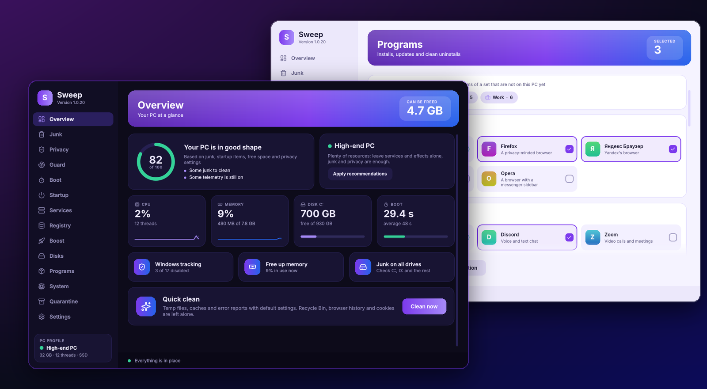
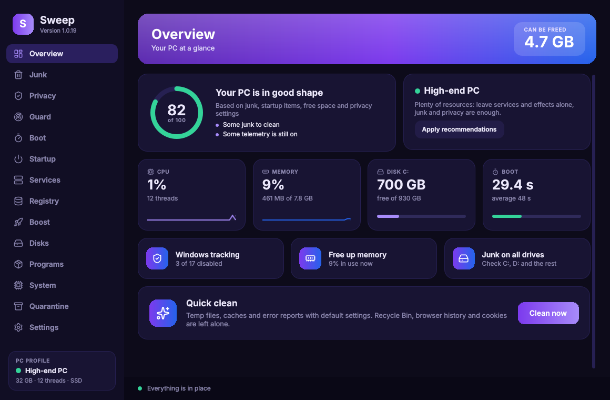
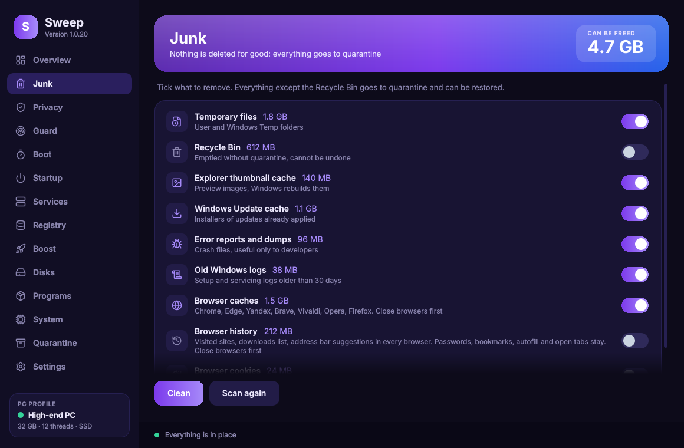
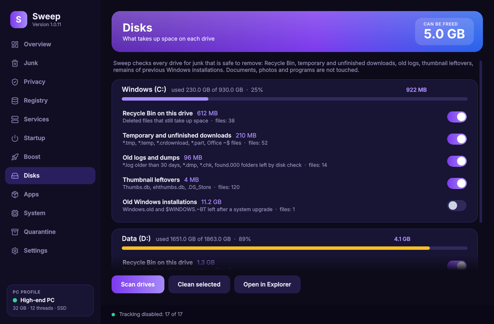
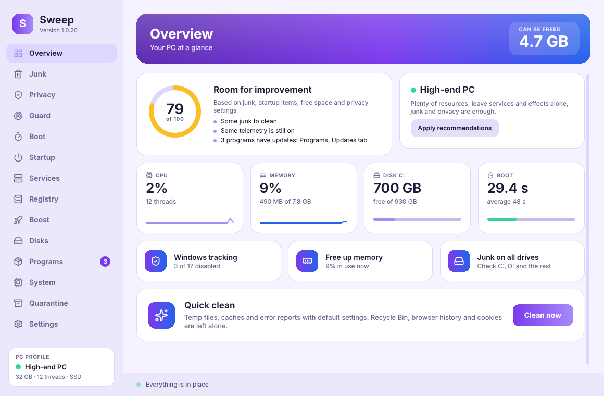

# Sweep

  
  
  
  

<b>Clean, de-bloat and speed up Windows in one click.</b> Free, open source, no ads, no telemetry.

**Version 1.0** is a full rewrite: a native-feeling Qt interface with smooth animations, live CPU, memory and disk monitors, a **PC profile** that adapts recommendations to weak, mid-range and powerful machines, Windows visual-effects and power-plan presets, English and Russian, dark and light themes with five accent colours.

Windows 10 and 11. Sweep goes online only to check GitHub for updates (on start unless you turn it off, or when you press "Check for updates"). When a new version is out, Sweep shows what changed and asks before installing. The full history is in [CHANGELOG.md](CHANGELOG.md).

[Русская версия](README.ru.md)

## Download

Grab `Sweep-Setup-x.y.exe` from the [latest release](../../releases/latest) and run it. Sweep asks for administrator rights (the usual Windows UAC prompt) because privacy switches, services and system startup entries cannot be changed without them. If you decline, it still opens with a banner and a **Grant rights** button.

Windows SmartScreen may warn about an unknown publisher because the build is not code-signed yet. Click **More info**, then **Run anyway**. The full source is in this repository.

**Kaspersky users.** Kaspersky places unsigned programs into a restricted group and silently blocks their registry changes, so privacy switches will not stick. Add `C:\Program Files\Sweep\Sweep.exe` to trusted applications (Kaspersky settings → Threats and Exclusions → Specify trusted applications) and tick "Do not monitor application activity". Sweep recognises this situation and shows the same hint on the Privacy page.

## Screenshots

| | |
|---|---|
|  |  |
|  |  |

## What it does

**Overview.** A health index (0 to 100) with concrete tips, your PC profile with one-click recommendations, live CPU and memory graphs, disk and startup at a glance, and a quick clean button.

**Junk.** Shows how much space each category takes and removes only what you tick:
temp folders, Recycle Bin, thumbnail cache, Windows Update cache, crash dumps and error reports, old Windows logs, browser caches (Chrome, Edge, Yandex, Brave, Vivaldi, Opera, Firefox), browser history and, optionally, cookies. History cleaning removes visited sites, the downloads list and address bar suggestions in every browser; passwords, bookmarks, autofill and open tabs are never touched. In Firefox, where history and bookmarks share one database, only visits are removed and a copy of the database goes to quarantine first. Your ticks are remembered.

**Privacy.** 17 switches that work like Windows Settings (on means the feature is active, off means it is disabled) in three groups: data collection (telemetry, advertising ID, activity history, error reporting), ads and suggestions (Start menu, lock screen, Explorer, search box, news and widgets, "what's new" screen), Microsoft assistants (Cortana, Copilot, Edge telemetry). Every switch can be flipped back.

**Registry.** Safe categories only: recent-file lists, MuiCache, App Paths and Run entries pointing to deleted programs. Every key is exported to a `.reg` file before it is touched, and a **Restore** button imports it back.

**Services.** Twelve services that slow down older PCs (SysMain, Windows Search indexing, Xbox services, Maps, Fax, Remote Registry and more). The original startup type is remembered, so everything is reversible.

**Startup.** What launches with Windows, with a switch per entry. Nothing is deleted.

**Boost.** Free RAM, optimise drives (TRIM for SSD, defrag for HDD), Windows visual-effects presets (performance, balanced, appearance), power plan, Windows Update, and a weekly **scheduled auto-clean** that runs silently.

**Disks.** Every drive is scanned for junk that is safe to remove: its Recycle Bin, temporary and unfinished downloads, old logs and dumps, thumbnail leftovers, remains of previous Windows installations. Each item has its own switch; selected items go to quarantine.

**Apps.** Pre-installed Microsoft and partner apps most people never use (Xbox, Solitaire, News, Weather, Office Hub, Candy Crush and so on). Remove what you tick; anything can be reinstalled from Microsoft Store.

**System.** Windows build, CPU, GPU, motherboard, BIOS, RAM modules, disks, uptime, temperatures where Windows exposes them. Copy as text.

**Quarantine.** Nothing is deleted outright. Files are moved to `ProgramData\Sweep\Quarantine`, and **Restore** puts them back. Purge the quarantine yourself when you are sure.

**Settings.** English or Russian, dark or light theme, five accent colours, animations on or off, administrator rights status, how new versions arrive (ask me, install automatically or do not check).

The interface is drawn by the CPU, so the graphics card is not used at all and the mouse and games stay smooth while Sweep is open.

## Safety rules

- Files are moved, not deleted. Only the Recycle Bin is emptied for real, and it is off by default.
- Documents, photos, programs and licences are never touched.
- Privacy switches and services are reversible with the same switch.
- Registry cleaning backs up every key first.
- Files in use are skipped.

## Building from source

The app lives in `app/`: Python 3.12, PySide6 (Qt 6) with a QML interface, psutil. Run it from source with `python app/main.py` (on Linux or macOS it starts in demo mode with sample data, which is how the interface is developed and screenshotted).

Releases are built automatically by GitHub Actions on every push to `main` (see `.github/workflows/release.yml`): PyInstaller produces `dist/Sweep`, Inno Setup packs the installer, and a tag is created from `APP_VERSION` in `app/sweep/platform.py`.

The original PowerShell version (0.x) is kept in `legacy/`.

## Command line

`Sweep.exe --auto` runs a silent clean with default categories and exits. This is what the scheduled task uses.

## Code signing policy

Windows releases are being prepared for free code signing provided by [SignPath.io](https://about.signpath.io/), certificate by [SignPath Foundation](https://signpath.org/); until approval they are unsigned. Releases are built only by GitHub Actions from this repository, and every signing request is approved manually. Team: Alex (Drakedog) is committer, reviewer and approver. Details: [CODE_SIGNING_POLICY.md](CODE_SIGNING_POLICY.md).

## Privacy policy

Sweep collects and sends no personal data and no telemetry. It connects only to `api.github.com` and `github.com` to check for and download Sweep updates: on start-up (can be turned off in Settings) or when you press "Check for updates". This program will not transfer any other information to other networked systems unless specifically requested by the user or the person installing or operating it.

## Feedback and thanks

Found a bug or have an idea? [Open an issue](../../issues/new). If Sweep is useful to you, a star on this repository is the best way to say thanks and helps other people find it.

## License

MIT. Free to use, modify and share.
