<div align="center">


# Sweep

**Clean, de-bloat and speed up Windows 10 and 11. Safely.**

Free and open source · no ads · no telemetry · every change can be undone

[](../../releases/latest)
[](../../releases)
[](../../actions/workflows/release.yml)
[](../../actions/workflows/selftest.yml)
[](../../actions/workflows/ci.yml)
<br>


[](LICENSE)

[**Download**](../../releases/latest) · [What's new](#whats-new) · [Features](#features) · [Screenshots](#screenshots) · [Safety](#how-sweep-keeps-you-safe) · [FAQ](#faq) · [Build](#building-from-source) · [Русский](README.ru.md)

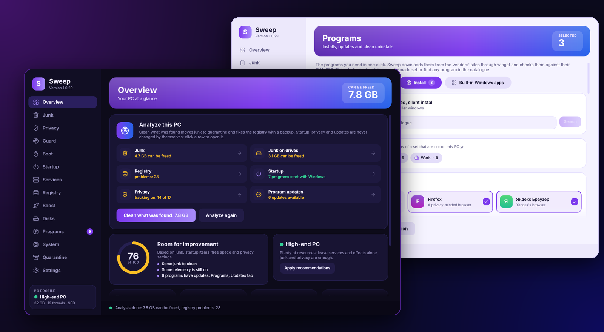

</div>

## Why Sweep

Most cleaners delete first and ask later. Sweep is built the other way round:

- **Reversible by design.** Files go to a quarantine, registry keys are exported before cleaning, a Windows restore point is created before big changes, and every switch flips back.
- **It remembers your choices.** Big Windows updates quietly turn telemetry and ads back on. **Guard** notices and puts your settings back.
- **Facts, not guesses.** Boot times come from Windows' own diagnostics log; outdated programs come from the Microsoft winget catalogue with SHA-256 checks.
- **Nothing phones home.** No accounts, no analytics, no ads. The code is right here.
- **Your choices stay yours.** Nothing is scanned or changed until you press a button, and cleaning never touches the programs you picked to open your videos, photos and documents.
- **Tested on real Windows.** Every change runs a self-test on a Windows machine that flips real privacy switches, cleans real browser history, checks that default apps survive a full clean, uninstalls a test program, and updates and installs real ones.

## What's new

- **Microsoft Store apps stay Store apps** (1.0.28). A program installed from the Store is updated by the Store; Sweep no longer puts the website version next to it and marks it "From Store" on the Install tab.
- **Sweep repairs winget by itself** (1.0.28). A damaged package source ("Failed when opening source(s)") is refreshed, registered again or reset, and the check is repeated.
- **Smooth everywhere** (1.0.28). The program icon, gradients and icons inside the app are antialiased at any scaling.
- **Tray and window** (1.0.26, 1.0.29). Sweep remembers its window, can stay in the tray, and a second start just brings the open window to the front.
- **Updates that survive a bad connection** (1.0.24). Sweep's own update resumes an interrupted download, checks SHA-256 and waits until Sweep is idle.
- **Analyze on the Overview** (1.0.22). One button checks junk, drives, registry, startup, privacy and program updates.

Every version is described in the [changelog](CHANGELOG.md).

## Features

<table>
<tr>
<td width="33%" valign="top"><b>Overview</b><br>One <b>Analyze</b> button checks junk, every drive, the registry, startup, privacy and program updates, then <b>Clean what was found</b>. Health score and live graphs.</td>
<td width="33%" valign="top"><b>Junk</b><br>Temp files, caches, update leftovers, crash dumps, browser caches and history. Passwords and bookmarks are never touched.</td>
<td width="33%" valign="top"><b>Privacy</b><br>17 switches that work like Windows Settings: telemetry, advertising ID, ads in Start, Copilot, Edge data and more.</td>
</tr>
<tr>
<td valign="top"><b>Guard</b><br>Watches what you turned off or removed and restores it after Windows updates, with notifications and a history.</td>
<td valign="top"><b>Boot X-ray</b><br>How long Windows takes to start, which apps, services and drivers slow it down, and by how many seconds.</td>
<td valign="top"><b>Programs</b><br>Thorough uninstaller: runs the program's own uninstaller, then finds leftovers in folders, registry, tasks and services.</td>
</tr>
<tr>
<td valign="top"><b>Updates and installs</b><br>Updates outdated programs and installs new ones in one click from the vendors' official sites, each file verified by SHA-256.</td>
<td valign="top"><b>Startup and services</b><br>Run keys, Startup folders and Store apps in one list that is always fresh, newcomers marked. Services you can safely pause.</td>
<td valign="top"><b>Boost and disks</b><br>Free RAM, TRIM or defrag, visual-effects and power presets, junk on every drive, weekly silent auto-clean.</td>
</tr>
<tr>
<td valign="top"><b>Registry</b><br>Safe categories only, file associations never touched, every key backed up to a <code>.reg</code> file with a Restore button.</td>
<td valign="top"><b>System</b><br>CPU, GPU, board, BIOS, memory modules, disks and temperatures on one screen. Copy as text.</td>
<td valign="top"><b>Made with care</b><br>English and Russian, dark and light themes down to the window title bar, five accents, sharp at any scaling. Remembers its window, can live in the tray, opens only once. Drawn by the CPU, so games stay smooth.</td>
</tr>
</table>

<details>
<summary><b>Every page in detail</b></summary>

**Overview.** Nothing is scanned when Sweep starts. Press **Analyze** and it checks everything in one go: junk, junk on every drive, the registry, startup, privacy and program updates, each with its own result row that opens the page behind it. **Clean what was found** moves the ticked junk to quarantine and fixes the registry with a backup; Recycle Bins are not emptied this way, and startup, privacy and updates are only shown, never changed by themselves. Below are a health index (0 to 100) with concrete tips, your PC profile with one-click recommendations, live CPU and memory graphs, and a quick clean button.

**Junk.** Shows how much space each category takes and removes only what you tick: temp folders (files older than a day, so a running installer keeps what it unpacked), Recycle Bin, thumbnail cache, Windows Update cache, crash dumps and error reports, old Windows logs, browser caches (Chrome, Edge, Yandex, Brave, Vivaldi, Opera, Firefox), browser history and, optionally, cookies. History cleaning removes visited sites, the downloads list and address bar suggestions; passwords, bookmarks, autofill and open tabs are never touched. In Firefox, where history and bookmarks share one database, only visits are removed and a copy of the database goes to quarantine first. Files Windows will replace at the next restart stay put, and the Windows Update cache is left alone while an update is installing or waits for a restart.

**Privacy.** 17 switches that work like Windows Settings (on means the feature is active) in three groups: data collection (telemetry, advertising ID, activity history, error reporting), ads and suggestions (Start menu, lock screen, Explorer, search box, news and widgets), Microsoft assistants (Cortana, Copilot, Edge telemetry).

**Guard.** Remembers what you switched off or removed, checks after you sign in and once a day, and either notifies you or puts everything back by itself. Every finding is kept in a history.

**Boot X-ray.** Boot time split into "until the desktop" and "after sign-in", a chart of recent boots and the culprits in seconds, straight from the Diagnostics-Performance log. Remove a culprit from startup in one click, restart, and the next bar shows what you saved.

**Programs.** Every installed program with its icon, size and date. Sweep runs the program's own uninstaller, then finds what it left behind (program folders, AppData, ProgramData, registry keys, shortcuts, Run entries, scheduled tasks, services) and shows the list before removing anything. Force mode handles programs whose uninstaller is broken; locked files are removed at the next restart, and registry keys an installer locked against changes are unlocked first. When everything still works, **All works, delete the copies** removes the backups of that uninstall for good.

**Updates.** Sweep asks winget, the package manager built into Windows, which installed programs have a newer version, with a progress bar while it looks. Each one shows where the installer comes from (7-zip.org, videolan.org, github.com/notepad-plus-plus and so on) and what is new in the version. Nothing is ticked by itself: tick what you want or press Update all, and Sweep updates them one by one, silently, with the download in megabytes and a percentage for every program; winget refuses to run any file whose SHA-256 differs from the catalogue. Afterwards Sweep reads the installed version again, so "updated" always means the new version is really there. Forks and look-alikes that winget mistakes for the original program (FlClash X for FlClash, say) are flagged and never updated by accident. A dropped connection or a busy vendor server gets one more try a few seconds later; installers that refuse administrator rights (Spotify, for one) are run as you instead. After the updates Sweep tells you if Windows needs a restart to finish, and if an open program has to be closed and opened again to switch to its new version. Programs you installed from Microsoft Store are updated by the Store: Sweep shows them with a button that opens the Store's updates page and never runs the website installer over them, which would add a second copy. When winget cannot check at all (an old winget on Windows 10, a source that will not open), Sweep says so with winget's own message instead of claiming everything is up to date, and offers to update winget. A damaged winget source ("Failed when opening source(s)") is repaired first: refreshed, registered again or reset, without touching sources you added.

**Install.** Popular free programs in one click, by category (browsers, messaging, video and music, documents, utilities, passwords, games, development, components), plus ready-made sets for a fresh Windows, gaming or work, and a search through the whole winget catalogue. Programs already on the PC are marked, including ones you have from Microsoft Store; the rest install one after another from the vendors' sites, with the same live progress and SHA-256 check.

**Built-in apps.** Removes pre-installed Microsoft and partner apps (Xbox, Solitaire, News, Candy Crush and so on); any of them can be reinstalled from Microsoft Store. An app that opens some file types on your PC (Media Player for videos, say) is marked with those types, because removing it makes Windows forget that choice. Guard never removes an app you picked again to open files.

**Registry.** Recent-file lists (your history, so not ticked by default), plus MuiCache, App Paths and Run entries of programs that are gone. Store app aliases and plain commands such as `rundll32.exe` are never mistaken for missing files, and file associations and default apps are never touched. Every key is exported to a `.reg` file before it is changed; old backups can be restored or deleted one by one.

**Startup.** Everything that starts with Windows: Run keys of the user and of the whole system, both Startup folders and Microsoft Store apps, with the same on and off state Task Manager shows. The list is read again every time you open the page, and programs that added themselves since your last look are marked **new**. Entries locked by a policy are shown but cannot be switched.

**Services.** Twelve services that slow down older PCs (SysMain, Windows Search indexing, Xbox services, Maps, Fax, Remote Registry and more). The original startup type is remembered.

**Boost.** Free RAM, optimise drives, visual-effects presets, power plan, Windows Update, and a weekly scheduled auto-clean.

**Disks.** Every drive is scanned for junk that is safe to remove: its Recycle Bin, unfinished downloads, old logs and dumps, remains of previous Windows installations. Temp and download files from today are kept, and program data (AppData, browser and app databases) is never searched, so a database journal is never mistaken for a log.

**Quarantine.** Files are moved to `ProgramData\Sweep\Quarantine`. **Restore** puts a session back, **Delete** removes it for good, and copies older than 30 days are deleted by themselves (you can turn that off in Settings).

**Settings.** Language, theme, accent colour, animations, restore points, administrator rights, automatic removal of old copies, what the close button does (ask, minimise to the tray, quit), and how new versions of Sweep arrive (ask me, install automatically, or do not check).

</details>

## Screenshots

| | |
|:---:|:---:|
| 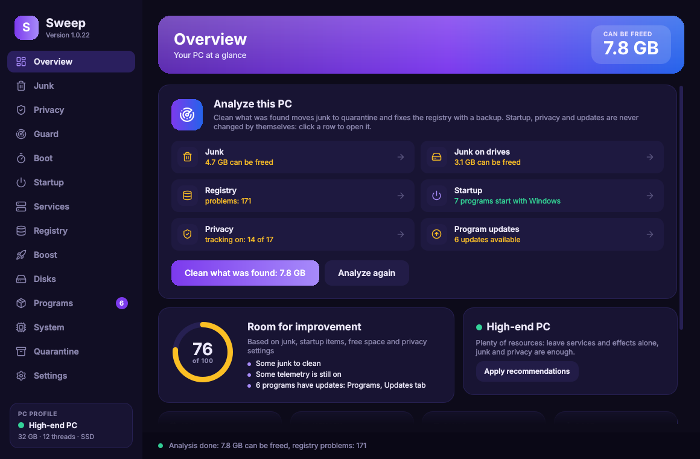 | 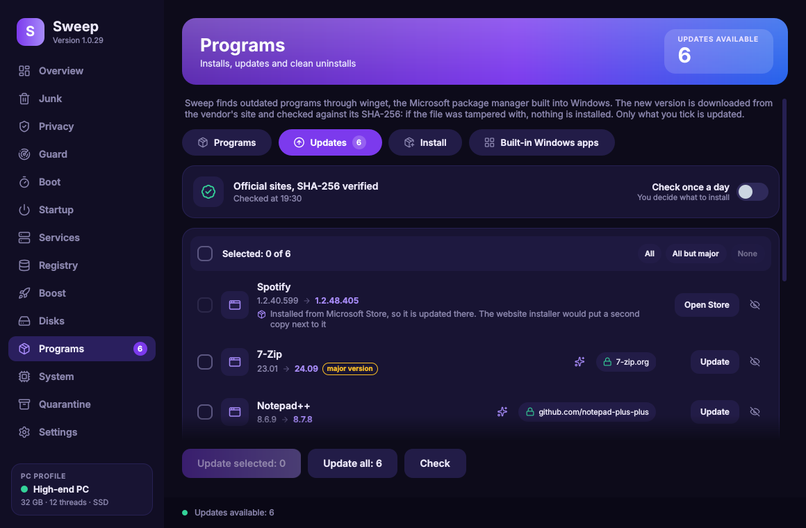 |
| **Overview: Analyze checks everything in one go** | **Program updates with live progress** |
| 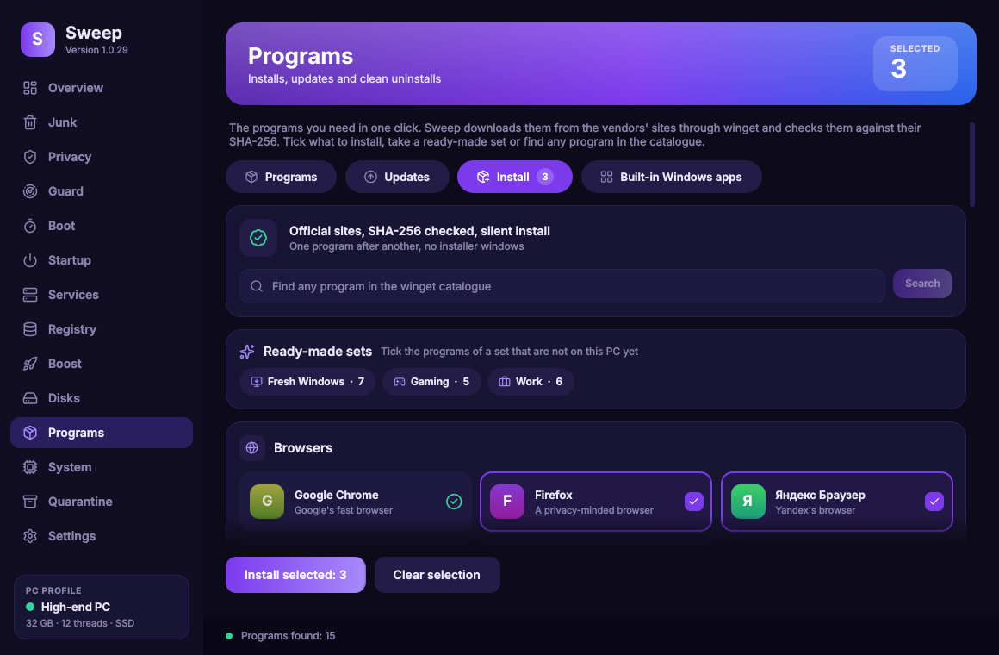 | 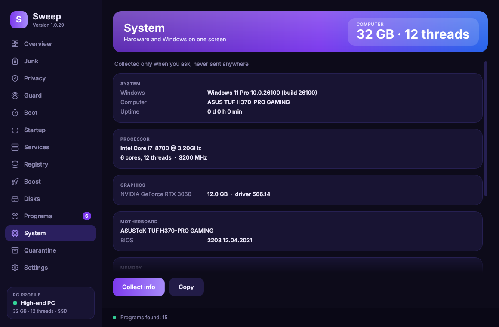 |
| **Install in one click** | **Thorough uninstaller** |
| 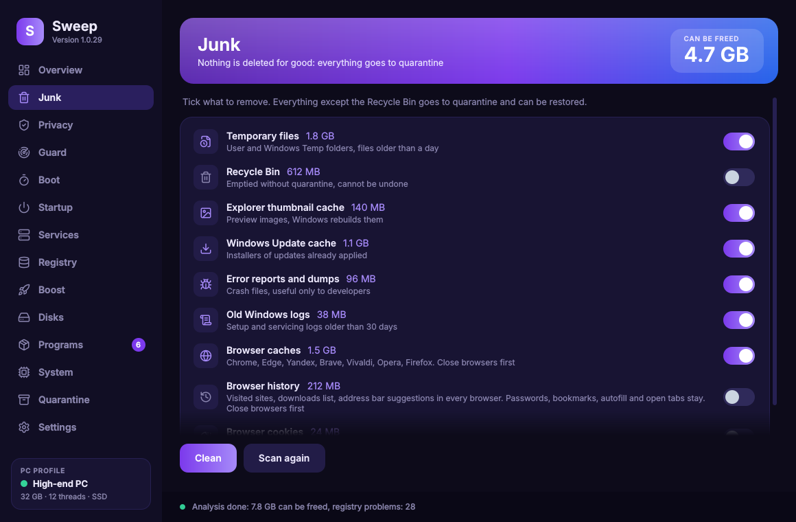 | 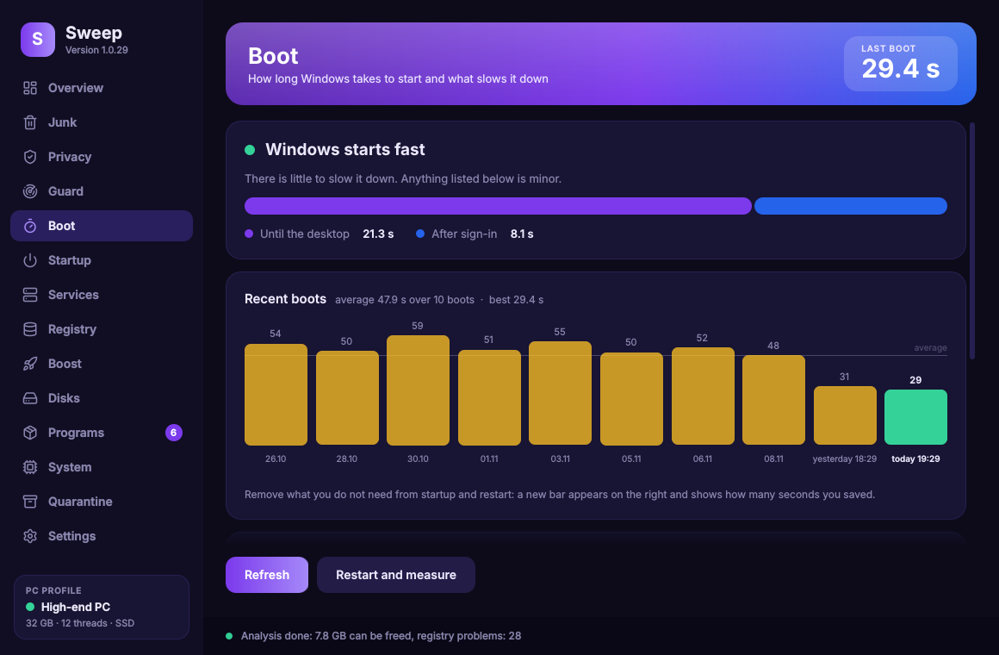 |
| **Junk** | **Boot X-ray** |
| 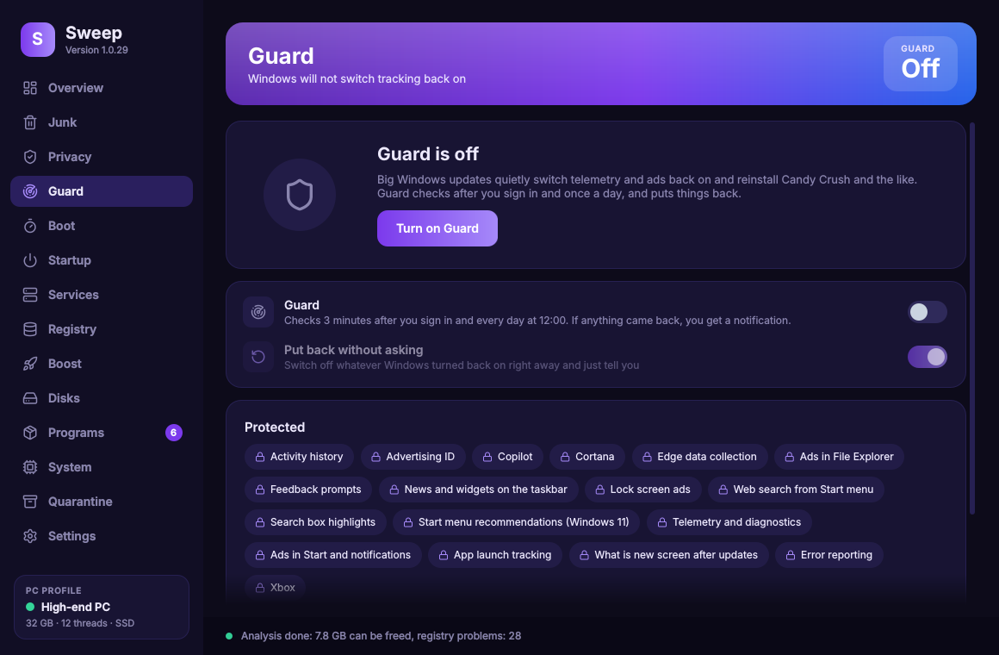 | 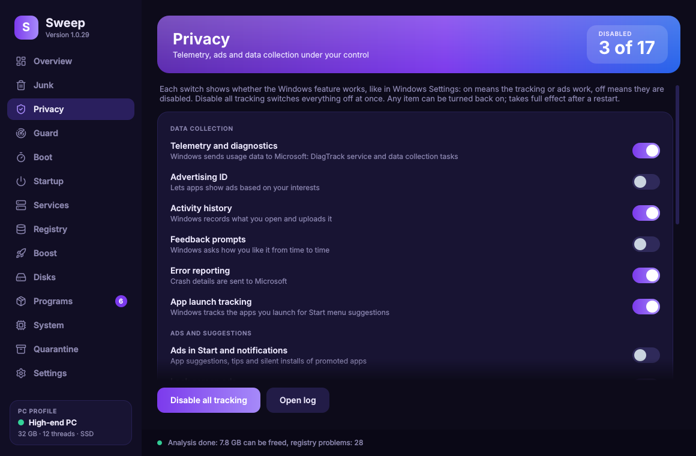 |
| **Guard** | **Privacy** |
| 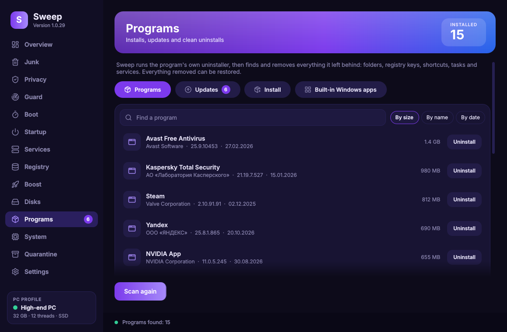 | 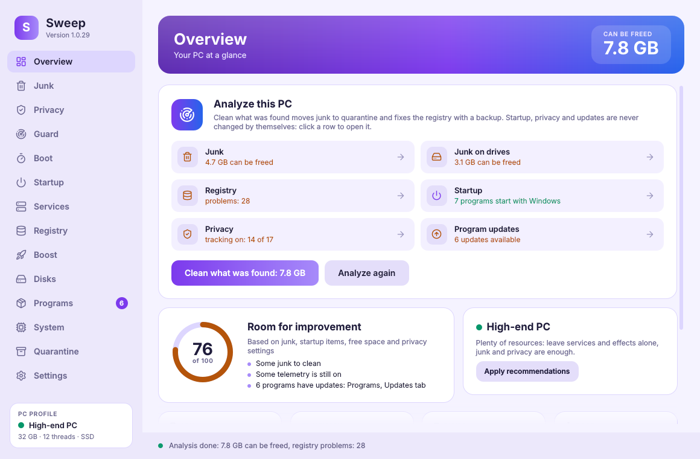 |
| **Disks** | **Light theme** |

## Download

1. Get **`Sweep-Setup-x.y.z.exe`** from the [latest release](../../releases/latest).
2. Run it. Sweep asks for administrator rights (the usual UAC prompt): privacy switches, services and system startup cannot be changed without them. If you say no, it still opens and shows a **Grant rights** button.
3. Sweep checks for its own updates when it starts (and once a day if it stays in the tray) and asks before installing them. It never restarts itself in the middle of a program update or a clean, picks up an interrupted download where it stopped, and starts the new installer only if its SHA-256 matches the one published with the release. If api.github.com cannot be reached, it asks github.com itself.

<details>
<summary><b>Windows SmartScreen says "unknown publisher"</b></summary>

Releases are not code-signed yet (see [code signing](#code-signing-policy)). Click **More info**, then **Run anyway**. Every release is built by GitHub Actions from this repository, and the release page lists the SHA-256 of the installer so you can check it with `Get-FileHash`.
</details>

<details>
<summary><b>Kaspersky users</b></summary>

Kaspersky puts unsigned programs into a restricted group. It can silently block their registry changes (privacy switches will not stick) and cut their internet connections, including those of winget started by Sweep: update checks then fail with "connection closed" although GitHub opens in the browser. Add `C:\Program Files\Sweep\Sweep.exe` to trusted applications (Settings → Threats and Exclusions → Specify trusted applications) and tick "Do not monitor application activity", "Do not inherit restrictions of the parent process (application)", "Do not monitor child application activity" and "Do not scan encrypted traffic" (use the folder you installed Sweep to if you changed it). If Kaspersky crashes in that dialog, quit Sweep first, or search Kaspersky settings for Application management and move Sweep to the Trusted group. Sweep recognises both situations and shows these hints on the Privacy page and next to update checks. Code signing (see below) will make this unnecessary.
</details>

## How Sweep keeps you safe

| Action | Safety net |
|---|---|
| Junk, leftovers, browser history | Moved to quarantine, restorable with one click; deleted after 30 days unless you turn that off |
| Registry cleaning, uninstall leftovers | Every key exported to a `.reg` backup first |
| Privacy switches, services, startup | The same switch turns it back; Guard keeps your choice |
| Big changes (privacy, uninstall, updates) | Windows restore point first (at most once a day) |
| Program updates and installs | Vendor's official installer only, SHA-256 checked by winget; forks and look-alikes are flagged, never updated by accident |
| Sweep's own updates | Offered when Sweep is idle, resumed after a dropped connection, run only if the SHA-256 matches the release |
| Default apps and file associations | Never touched by cleaning; built-in apps that open your files are marked before removal |
| Files in use | Skipped, or removed at the next restart if you force it |

Documents, photos, licences, passwords and your default apps are never touched. Only the Recycle Bin is emptied for real, and that category is off by default.

## FAQ

<details>
<summary><b>Does Sweep send anything anywhere?</b></summary>

No personal data, statistics or telemetry. It contacts GitHub to check for Sweep updates (can be turned off), and when you check for program updates or search for and install programs, winget contacts the Microsoft catalogue and the vendors' download sites. Details: [PRIVACY.md](PRIVACY.md).
</details>

<details>
<summary><b>How do I undo something?</b></summary>

Files: **Quarantine → Restore**. Registry: **Registry → backups → Restore**. Switches: flip them back. For anything bigger, Windows **System Restore** has a point Sweep created before the change.
</details>

<details>
<summary><b>Will cleaning reset my default apps?</b></summary>

No. Sweep never touches file associations, so videos, photos and documents keep opening in the program you chose. If Windows does ask again, the program that used to open those files was most likely removed: the **Built-in Windows apps** tab marks such apps (Media Player, for example) before you remove them.
</details>

<details>
<summary><b>Will it break Windows Update, Defender or Microsoft Store?</b></summary>

No. Sweep does not disable security features, does not remove Store, Defender or Windows Update, and does not touch system files.
</details>

<details>
<summary><b>Which Windows versions are supported?</b></summary>

Windows 10 and Windows 11, 64-bit. Program updates and installs need winget (App Installer), which ships with both and is free in Microsoft Store.
</details>

<details>
<summary><b>Sweep says it cannot reach GitHub, or that winget could not check</b></summary>

If GitHub opens in your browser, something on the PC is cutting Sweep's connections, most often an antivirus that keeps unsigned programs offline (see **Kaspersky users** above). Otherwise it is the network: try again later or with a VPN. Without a working connection Sweep never pretends everything is up to date: it shows what went wrong.
</details>

<details>
<summary><b>Does Sweep run in the background?</b></summary>

Only if you want it to. When you close the window, Sweep asks whether to quit or stay in the tray next to the clock (Settings → When the window is closed). In the tray it uses no CPU, checks for updates once a day if that is on, and quits from the tray icon's menu. Guard and scheduled cleaning are Windows tasks and work either way.
</details>

<details>
<summary><b>How do I remove Sweep?</b></summary>

Windows Settings → Apps → Sweep → Uninstall. If Guard is on, its scheduled task is removed too.
</details>

## Under the hood

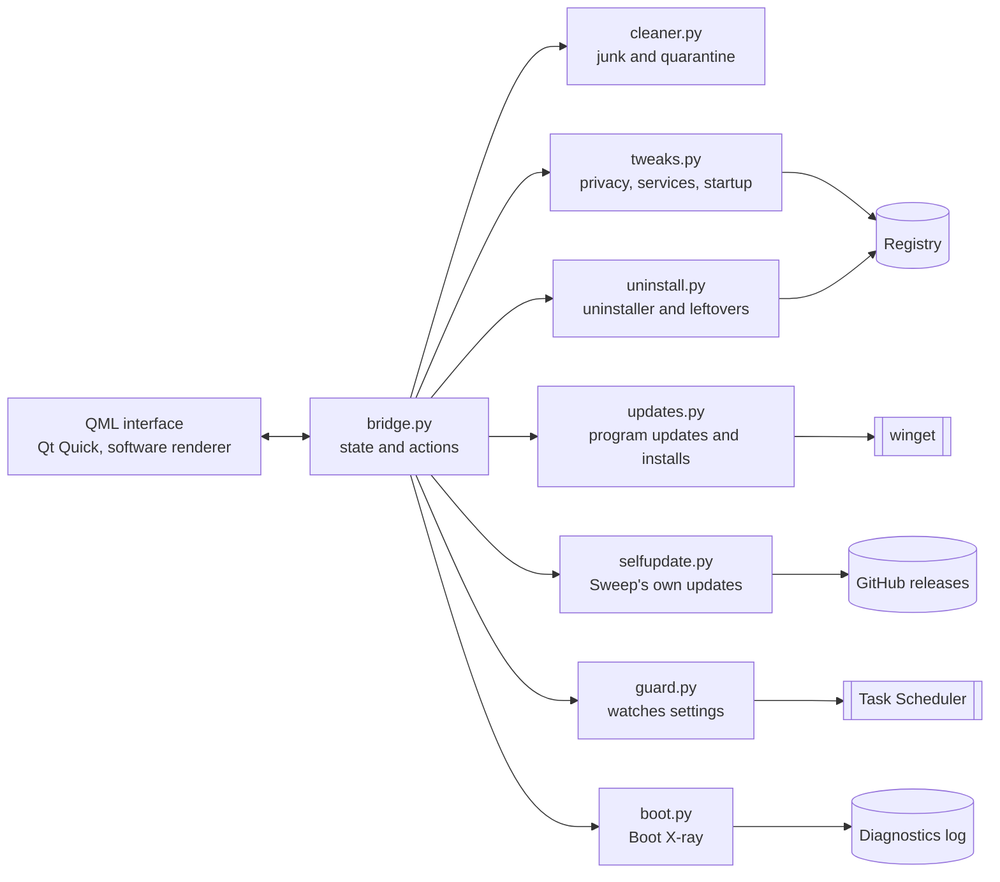

```text
app/
  main.py            entry point, UAC, --auto / --guard / --ui-test
  sweep/             all logic, plain Python, one module per feature
  qml/               interface: Main.qml, pages/, components/, Sweep/Theme.qml
  tests/             unit tests (winget parser, update download), Windows self-test
  Sweep.iss          Inno Setup installer
.github/workflows/   release build, Windows self-test, lint and tests
docs/                screenshots and images for this page
tools/               helper scripts (icon font subset, program icon)
legacy/              the original PowerShell version 0.x
```

Every push runs three pipelines:

- **Lint and tests** on Linux: ruff, unit tests (winget parser; Sweep's update download against a server that drops the connection), and the whole interface in demo mode with zero QML warnings allowed.
- **Windows self-test** on a real Windows machine: privacy switches written and read back, startup entries switched, browser history cleaned and restored, default apps checked unchanged after a full clean, Guard, restore points, a test program uninstalled end to end, a real program updated through winget, winget run as the signed-in user, and the latest Sweep release downloaded and checked against its SHA-256 by both routes (api.github.com and github.com).
- **Release build**: PyInstaller and Inno Setup, then the packaged `Sweep.exe` opens every page before the release is published.

## Building from source

```powershell
git clone https://github.com/drakedog-dev/sweep.git
cd sweep
pip install -r app/requirements.txt
python app/main.py
```

On Linux or macOS Sweep starts in **demo mode** with sample data; that is how the interface is developed and screenshotted. Tests:

```powershell
python app/tests/test_updates.py                 # anywhere
python app/tests/test_selfupdate.py              # anywhere
python app/main.py --ui-test --no-elevate        # every page, fails on any QML warning
python app/tests/selftest.py                     # Windows only, as administrator; changes and restores real settings
```

Releases are built by GitHub Actions when `APP_VERSION` in `app/sweep/platform.py` changes. See [CONTRIBUTING.md](CONTRIBUTING.md) for the details.

### Command line

| Option | What it does |
|---|---|
| `--auto` | Silent clean with your saved categories, used by the weekly scheduled task |
| `--guard` | Guard check without a window, used by its scheduled task |
| `--page <name>` | Open on a page: `overview`, `junk`, `privacy`, `guard`, `boot`, `apps` and so on |
| `--no-elevate` | Do not ask for administrator rights |
| `--ui-test` | Open every page offscreen and exit with an error on any QML warning |

## Code signing policy

Free code signing provided by [SignPath.io](https://about.signpath.io/), certificate by [SignPath Foundation](https://signpath.org/). Signing starts once the project is approved; until then releases are unsigned. Releases are built only by GitHub Actions from this repository, and every signing request is approved manually. Committer, reviewer and approver: Alex (Drakedog). Details: [CODE_SIGNING_POLICY.md](CODE_SIGNING_POLICY.md).

## Privacy policy

This program will not transfer any information to other networked systems unless specifically requested by the user or the person installing or operating it. Full text: [PRIVACY.md](PRIVACY.md).

## Contributing

Bug reports, ideas and pull requests are welcome: [open an issue](../../issues/new/choose) or read [CONTRIBUTING.md](CONTRIBUTING.md). Security problems: [SECURITY.md](SECURITY.md). History of changes: [CHANGELOG.md](CHANGELOG.md).

If Sweep is useful to you, a star on this repository is the best way to say thanks and helps other people find it.

## Acknowledgements

[Qt for Python (PySide6)](https://doc.qt.io/qtforpython-6/) · [psutil](https://github.com/giampaolo/psutil) · [Lucide icons](https://lucide.dev) · [winget](https://github.com/microsoft/winget-cli) · [PyInstaller](https://pyinstaller.org) · [Inno Setup](https://jrsoftware.org/isinfo.php)

## Licence

[MIT](LICENSE) © Alex (Drakedog)
