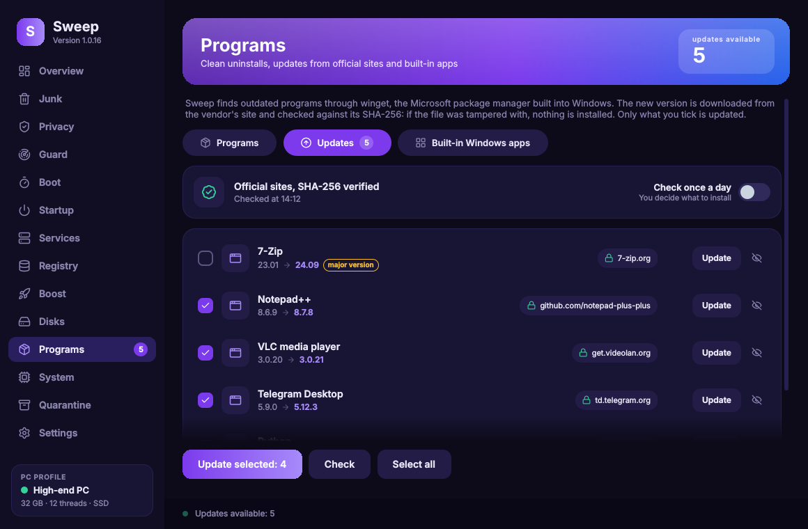
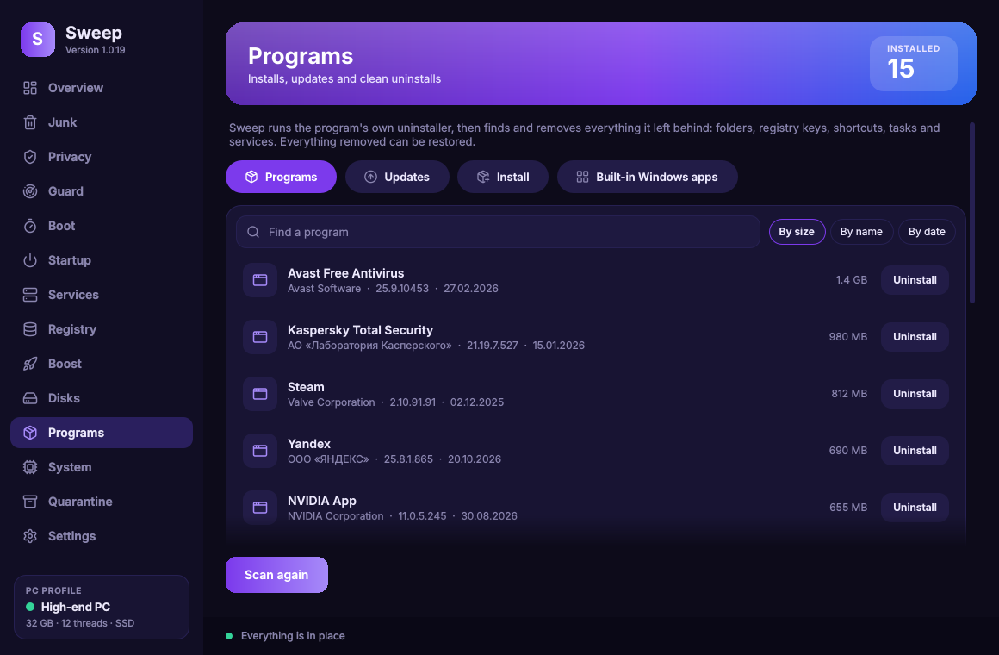
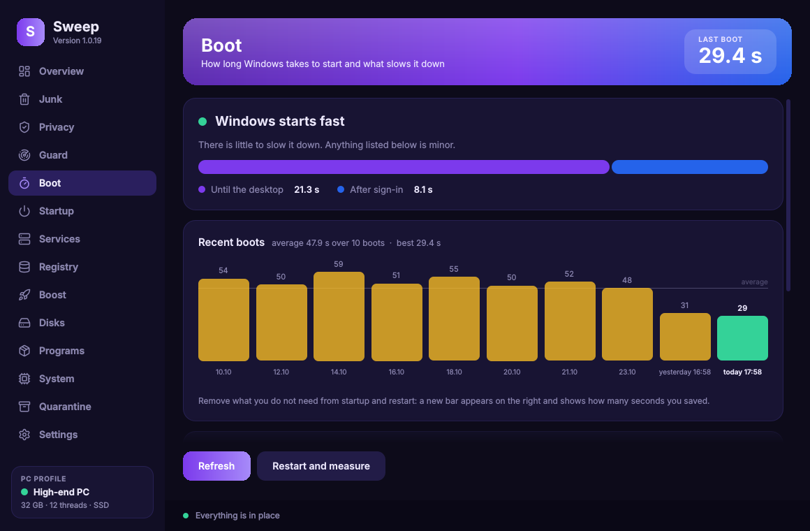
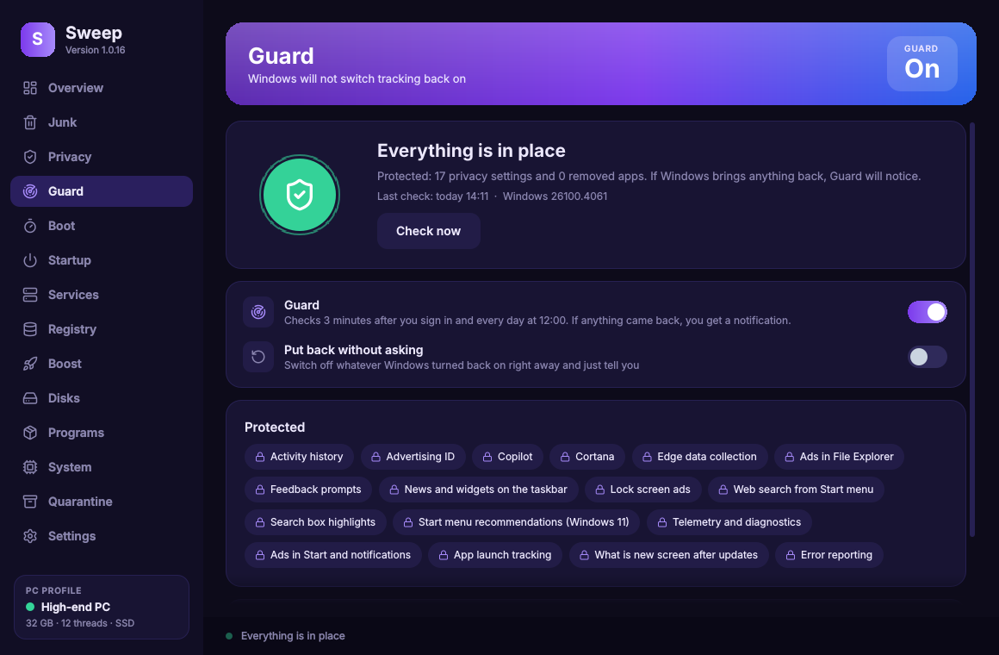
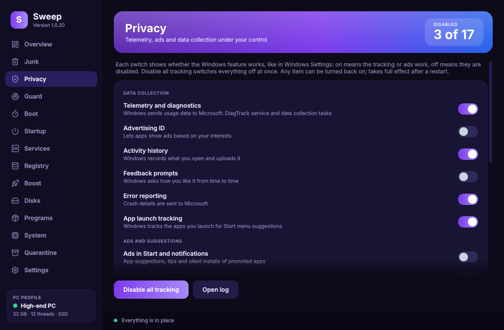
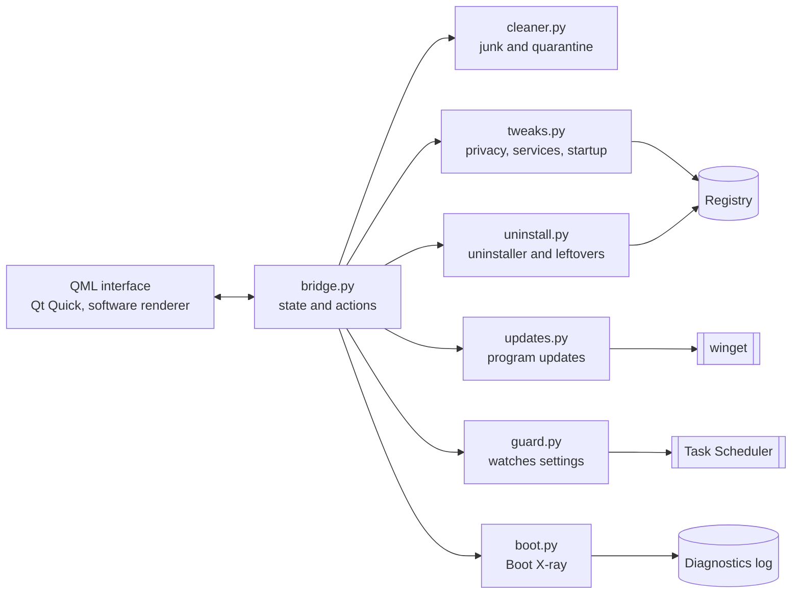

<div align="center">


# Sweep

**Clean, de-bloat and speed up Windows 10 and 11. Safely.**

Free and open source · no ads · no telemetry · every change can be undone

[](../../releases/latest)
[](../../releases)
[](../../actions/workflows/release.yml)
[](../../actions/workflows/selftest.yml)
[](../../actions/workflows/ci.yml)
<br>


[](LICENSE)

[**Download**](../../releases/latest) · [Features](#features) · [Screenshots](#screenshots) · [Safety](#how-sweep-keeps-you-safe) · [FAQ](#faq) · [Build](#building-from-source) · [Русский](README.ru.md)


</div>

## Why Sweep

Most cleaners delete first and ask later. Sweep is built the other way round:

- **Reversible by design.** Files go to a quarantine, registry keys are exported before cleaning, a Windows restore point is created before big changes, and every switch flips back.
- **It remembers your choices.** Big Windows updates quietly turn telemetry and ads back on. **Guard** notices and puts your settings back.
- **Facts, not guesses.** Boot times come from Windows' own diagnostics log; outdated programs come from the Microsoft winget catalogue with SHA-256 checks.
- **Nothing phones home.** No accounts, no analytics, no ads. The code is right here.
- **Tested on real Windows.** Every change runs a self-test on a Windows machine that flips real privacy switches, cleans real browser history, uninstalls a test program and updates a real one.

## Features

<table>
<tr>
<td width="33%" valign="top"><b>Overview</b><br>Health score with concrete tips, PC profile with one-click recommendations, live CPU and memory graphs.</td>
<td width="33%" valign="top"><b>Junk</b><br>Temp files, caches, update leftovers, crash dumps, browser caches and history. Passwords and bookmarks are never touched.</td>
<td width="33%" valign="top"><b>Privacy</b><br>17 switches that work like Windows Settings: telemetry, advertising ID, ads in Start, Copilot, Edge data and more.</td>
</tr>
<tr>
<td valign="top"><b>Guard</b><br>Watches what you turned off or removed and restores it after Windows updates, with notifications and a history.</td>
<td valign="top"><b>Boot X-ray</b><br>How long Windows takes to start, which apps, services and drivers slow it down, and by how many seconds.</td>
<td valign="top"><b>Programs</b><br>Thorough uninstaller: runs the program's own uninstaller, then finds leftovers in folders, registry, tasks and services.</td>
</tr>
<tr>
<td valign="top"><b>Updates</b><br>Finds outdated programs and updates the ones you tick from the vendors' official sites, each file verified by SHA-256.</td>
<td valign="top"><b>Startup and services</b><br>What launches with Windows and which background services you can safely pause, all reversible.</td>
<td valign="top"><b>Boost and disks</b><br>Free RAM, TRIM or defrag, visual-effects and power presets, junk on every drive, weekly silent auto-clean.</td>
</tr>
<tr>
<td valign="top"><b>Registry</b><br>Safe categories only, every key backed up to a <code>.reg</code> file with a Restore button.</td>
<td valign="top"><b>System</b><br>CPU, GPU, board, BIOS, memory modules, disks and temperatures on one screen. Copy as text.</td>
<td valign="top"><b>Made with care</b><br>English and Russian, dark and light themes, five accents. Drawn by the CPU, so games stay smooth.</td>
</tr>
</table>

<details>
<summary><b>Every page in detail</b></summary>

**Overview.** A health index (0 to 100) with concrete tips, your PC profile with one-click recommendations, live CPU and memory graphs, disk and startup at a glance, and a quick clean button.

**Junk.** Shows how much space each category takes and removes only what you tick: temp folders, Recycle Bin, thumbnail cache, Windows Update cache, crash dumps and error reports, old Windows logs, browser caches (Chrome, Edge, Yandex, Brave, Vivaldi, Opera, Firefox), browser history and, optionally, cookies. History cleaning removes visited sites, the downloads list and address bar suggestions; passwords, bookmarks, autofill and open tabs are never touched. In Firefox, where history and bookmarks share one database, only visits are removed and a copy of the database goes to quarantine first.

**Privacy.** 17 switches that work like Windows Settings (on means the feature is active) in three groups: data collection (telemetry, advertising ID, activity history, error reporting), ads and suggestions (Start menu, lock screen, Explorer, search box, news and widgets), Microsoft assistants (Cortana, Copilot, Edge telemetry).

**Guard.** Remembers what you switched off or removed, checks after you sign in and once a day, and either notifies you or puts everything back by itself. Every finding is kept in a history.

**Boot X-ray.** Boot time split into "until the desktop" and "after sign-in", a chart of recent boots and the culprits in seconds, straight from the Diagnostics-Performance log. Remove a culprit from startup in one click, restart, and the next bar shows what you saved.

**Programs.** Every installed program with its icon, size and date. Sweep runs the program's own uninstaller, then finds what it left behind (program folders, AppData, ProgramData, registry keys, shortcuts, Run entries, scheduled tasks, services) and shows the list before removing anything. Force mode handles programs whose uninstaller is broken; locked files are removed at the next restart.

**Updates.** Sweep asks winget, the package manager built into Windows, which installed programs have a newer version. Each one shows where the installer comes from (7-zip.org, videolan.org, github.com/notepad-plus-plus and so on). Tick what you want and Sweep updates them one by one, silently; winget refuses to run any file whose SHA-256 differs from the catalogue. Major upgrades are not ticked by default, and any program can be hidden from the list.

**Built-in apps.** Removes pre-installed Microsoft and partner apps (Xbox, Solitaire, News, Candy Crush and so on); any of them can be reinstalled from Microsoft Store.

**Registry.** Recent-file lists, MuiCache, App Paths and Run entries pointing to deleted programs. Every key is exported to a `.reg` file before it is touched.

**Services.** Twelve services that slow down older PCs (SysMain, Windows Search indexing, Xbox services, Maps, Fax, Remote Registry and more). The original startup type is remembered.

**Boost.** Free RAM, optimise drives, visual-effects presets, power plan, Windows Update, and a weekly scheduled auto-clean.

**Disks.** Every drive is scanned for junk that is safe to remove: its Recycle Bin, unfinished downloads, old logs and dumps, remains of previous Windows installations.

**Quarantine.** Files are moved to `ProgramData\Sweep\Quarantine`, and **Restore** puts them back. Purge it yourself when you are sure.

**Settings.** Language, theme, accent colour, animations, restore points, administrator rights, and how new versions of Sweep arrive (ask me, install automatically, or do not check).

</details>

## Screenshots

| | |
|:---:|:---:|
|  |  |
| **Overview** | **Program updates** |
|  |  |
| **Thorough uninstaller** | **Junk** |
|  |  |
| **Boot X-ray** | **Guard** |
|  |  |
| **Privacy** | **Light theme** |

## Download

1. Get **`Sweep-Setup-x.y.z.exe`** from the [latest release](../../releases/latest).
2. Run it. Sweep asks for administrator rights (the usual UAC prompt): privacy switches, services and system startup cannot be changed without them. If you say no, it still opens and shows a **Grant rights** button.
3. Sweep checks for its own updates when it starts and asks before installing them.

<details>
<summary><b>Windows SmartScreen says "unknown publisher"</b></summary>

Releases are not code-signed yet (see [code signing](#code-signing-policy)). Click **More info**, then **Run anyway**. Every release is built by GitHub Actions from this repository, and the release page lists the SHA-256 of the installer so you can check it with `Get-FileHash`.
</details>

<details>
<summary><b>Kaspersky users</b></summary>

Kaspersky puts unsigned programs into a restricted group and silently blocks their registry changes, so privacy switches will not stick. Add `C:\Program Files\Sweep\Sweep.exe` to trusted applications (Settings → Threats and Exclusions → Specify trusted applications) and tick "Do not monitor application activity". Sweep recognises this situation and shows the same hint on the Privacy page.
</details>

## How Sweep keeps you safe

| Action | Safety net |
|---|---|
| Junk, leftovers, browser history | Moved to quarantine, restorable with one click |
| Registry cleaning, uninstall leftovers | Every key exported to a `.reg` backup first |
| Privacy switches, services, startup | The same switch turns it back; Guard keeps your choice |
| Big changes (privacy, uninstall, updates) | Windows restore point first (at most once a day) |
| Program updates | Vendor's official installer only, SHA-256 checked by winget |
| Files in use | Skipped, or removed at the next restart if you force it |

Documents, photos, licences and passwords are never touched. Only the Recycle Bin is emptied for real, and that category is off by default.

## FAQ

<details>
<summary><b>Does Sweep send anything anywhere?</b></summary>

No personal data, statistics or telemetry. It contacts GitHub to check for Sweep updates (can be turned off), and when you check for program updates, winget contacts the Microsoft catalogue and the vendors' download sites. Details: [PRIVACY.md](PRIVACY.md).
</details>

<details>
<summary><b>How do I undo something?</b></summary>

Files: **Quarantine → Restore**. Registry: **Registry → backups → Restore**. Switches: flip them back. For anything bigger, Windows **System Restore** has a point Sweep created before the change.
</details>

<details>
<summary><b>Will it break Windows Update, Defender or Microsoft Store?</b></summary>

No. Sweep does not disable security features, does not remove Store, Defender or Windows Update, and does not touch system files.
</details>

<details>
<summary><b>Which Windows versions are supported?</b></summary>

Windows 10 and Windows 11, 64-bit. Program updates need winget (App Installer), which ships with both and is free in Microsoft Store.
</details>

<details>
<summary><b>How do I remove Sweep?</b></summary>

Windows Settings → Apps → Sweep → Uninstall. If Guard is on, its scheduled task is removed too.
</details>

## Under the hood



```text
app/
  main.py            entry point, UAC, --auto / --guard / --ui-test
  sweep/             all logic, plain Python, one module per feature
  qml/               interface: Main.qml, pages/, components/, Sweep/Theme.qml
  tests/             winget parser unit tests, Windows self-test
  Sweep.iss          Inno Setup installer
.github/workflows/   release build, Windows self-test, lint and tests
docs/                screenshots and images for this page
tools/               helper scripts (icon font subset)
legacy/              the original PowerShell version 0.x
```

Every push runs three pipelines:

- **Lint and tests** on Linux: ruff, parser unit tests, and the whole interface in demo mode with zero QML warnings allowed.
- **Windows self-test** on a real Windows machine: privacy switches written and read back, browser history cleaned and restored, Guard, restore points, a test program uninstalled end to end, and a real program updated through winget.
- **Release build**: PyInstaller and Inno Setup, then the packaged `Sweep.exe` opens every page before the release is published.

## Building from source

```powershell
git clone https://github.com/drakedog-dev/sweep.git
cd sweep
pip install -r app/requirements.txt
python app/main.py
```

On Linux or macOS Sweep starts in **demo mode** with sample data; that is how the interface is developed and screenshotted. Tests:

```powershell
python app/tests/test_updates.py                 # anywhere
python app/main.py --ui-test --no-elevate        # every page, fails on any QML warning
python app/tests/selftest.py                     # Windows only, as administrator; changes and restores real settings
```

Releases are built by GitHub Actions when `APP_VERSION` in `app/sweep/platform.py` changes. See [CONTRIBUTING.md](CONTRIBUTING.md) for the details.

### Command line

| Option | What it does |
|---|---|
| `--auto` | Silent clean with your saved categories, used by the weekly scheduled task |
| `--guard` | Guard check without a window, used by its scheduled task |
| `--page <name>` | Open on a page: `overview`, `junk`, `privacy`, `guard`, `boot`, `apps` and so on |
| `--no-elevate` | Do not ask for administrator rights |
| `--ui-test` | Open every page offscreen and exit with an error on any QML warning |

## Code signing policy

Free code signing provided by [SignPath.io](https://about.signpath.io/), certificate by [SignPath Foundation](https://signpath.org/). Signing starts once the project is approved; until then releases are unsigned. Releases are built only by GitHub Actions from this repository, and every signing request is approved manually. Committer, reviewer and approver: Alex (Drakedog). Details: [CODE_SIGNING_POLICY.md](CODE_SIGNING_POLICY.md).

## Privacy policy

This program will not transfer any information to other networked systems unless specifically requested by the user or the person installing or operating it. Full text: [PRIVACY.md](PRIVACY.md).

## Contributing

Bug reports, ideas and pull requests are welcome: [open an issue](../../issues/new/choose) or read [CONTRIBUTING.md](CONTRIBUTING.md). Security problems: [SECURITY.md](SECURITY.md). History of changes: [CHANGELOG.md](CHANGELOG.md).

If Sweep is useful to you, a star on this repository is the best way to say thanks and helps other people find it.

## Acknowledgements

[Qt for Python (PySide6)](https://doc.qt.io/qtforpython-6/) · [psutil](https://github.com/giampaolo/psutil) · [Lucide icons](https://lucide.dev) · [winget](https://github.com/microsoft/winget-cli) · [PyInstaller](https://pyinstaller.org) · [Inno Setup](https://jrsoftware.org/isinfo.php)

## Licence

[MIT](LICENSE) © Alex (Drakedog)
