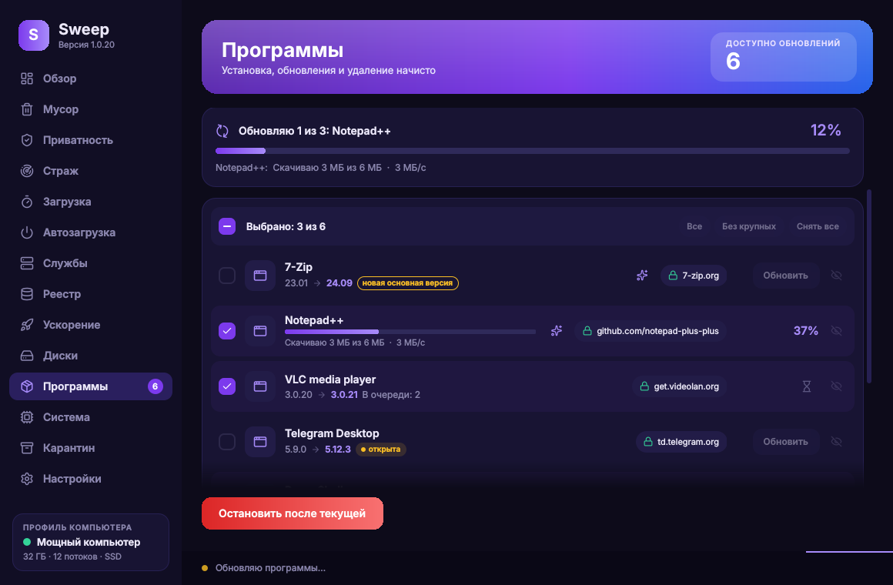
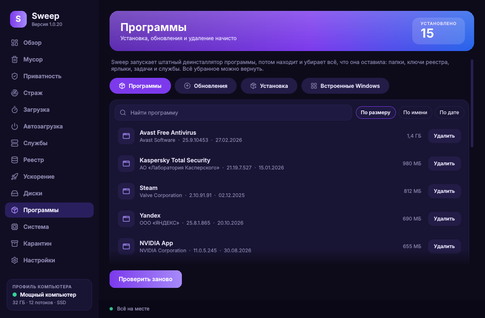
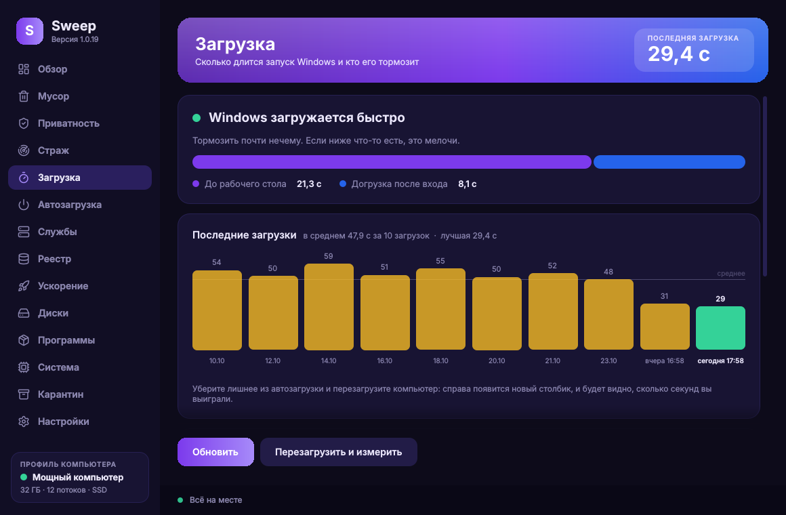
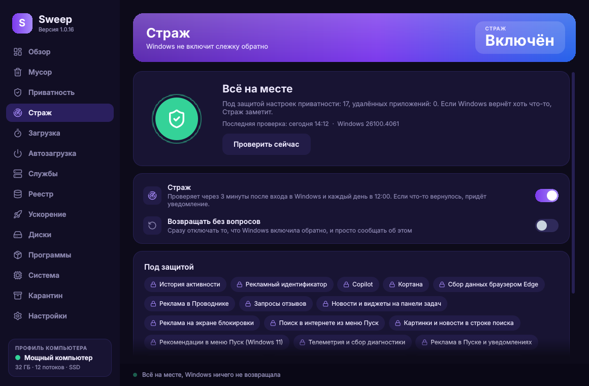
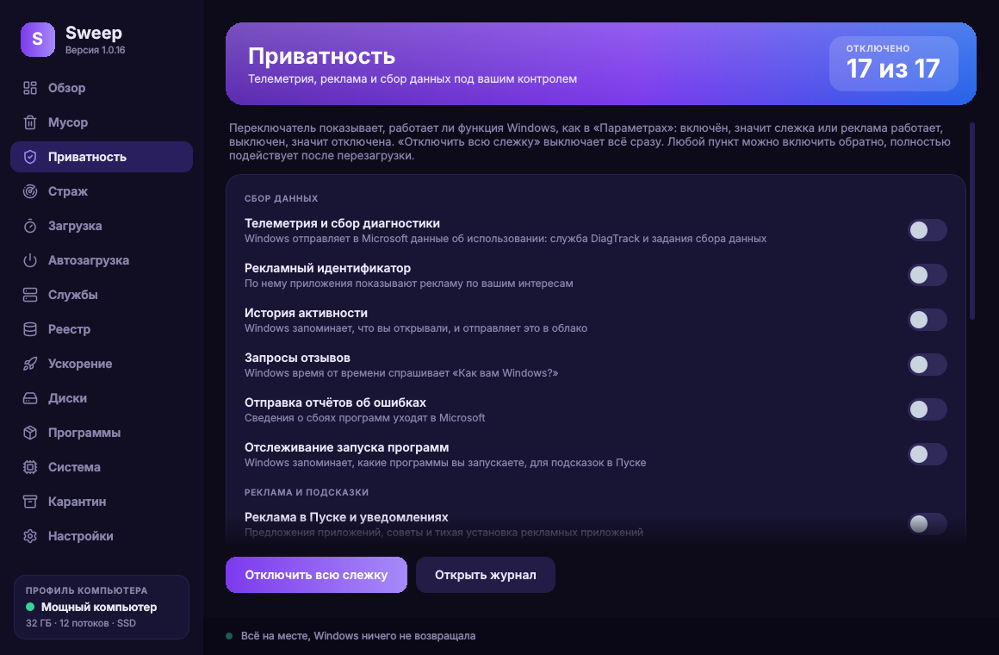
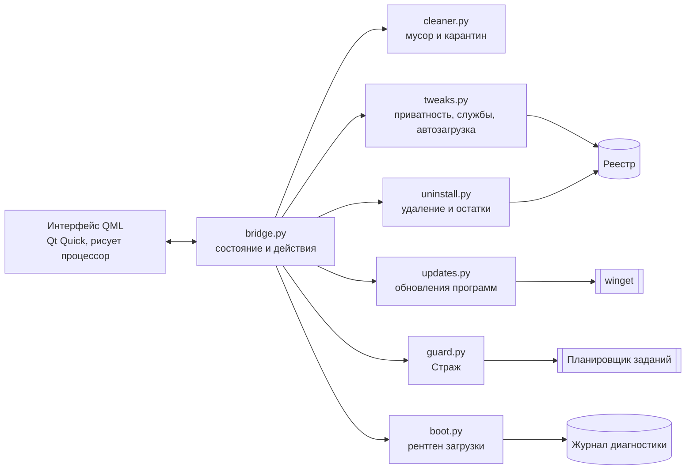

<div align="center">


# Sweep

**Очистка, удаление лишнего и ускорение Windows 10 и 11. Безопасно.**

Бесплатно и с открытым кодом · без рекламы · без телеметрии · любое изменение можно отменить

[](../../releases/latest)
[](../../releases)
[](../../actions/workflows/release.yml)
[](../../actions/workflows/selftest.yml)
[](../../actions/workflows/ci.yml)
<br>


[](LICENSE)

[**Скачать**](../../releases/latest) · [Возможности](#возможности) · [Скриншоты](#скриншоты) · [Безопасность](#как-sweep-бережёт-систему) · [Вопросы](#вопросы-и-ответы) · [Сборка](#сборка-из-исходников) · [English](README.md)


</div>

## Чем Sweep отличается

Большинство чистильщиков сначала удаляют, а потом спрашивают. Sweep устроен наоборот:

- **Всё обратимо.** Файлы попадают в карантин, ключи реестра сохраняются до очистки, перед крупными изменениями создаётся точка восстановления Windows, любой переключатель возвращается обратно.
- **Помнит ваш выбор.** Крупные обновления Windows тихо включают телеметрию и рекламу обратно. **Страж** это замечает и возвращает ваши настройки.
- **Факты, а не догадки.** Время загрузки берётся из диагностического журнала самой Windows, устаревшие программы из каталога Microsoft winget с проверкой SHA-256.
- **Ничего не отправляет.** Ни аккаунтов, ни аналитики, ни рекламы. Весь код здесь.
- **Проверен на настоящей Windows.** После каждого изменения на машине с Windows запускается самотест: он переключает настоящие настройки приватности, чистит настоящую историю браузеров, удаляет тестовую программу и обновляет реальную.

## Возможности

<table>
<tr>
<td width="33%" valign="top"><b>Обзор</b><br>Индекс здоровья с конкретными советами, профиль компьютера с рекомендациями в один клик, живые графики процессора и памяти.</td>
<td width="33%" valign="top"><b>Мусор</b><br>Временные файлы, кэши, остатки обновлений, дампы, кэш и история браузеров. Пароли и закладки не трогаются никогда.</td>
<td width="33%" valign="top"><b>Приватность</b><br>17 переключателей как в Параметрах Windows: телеметрия, рекламный ID, реклама в Пуске, Copilot, данные Edge и другое.</td>
</tr>
<tr>
<td valign="top"><b>Страж</b><br>Следит за тем, что вы отключили или удалили, и возвращает это после обновлений Windows, с уведомлениями и историей.</td>
<td valign="top"><b>Рентген загрузки</b><br>Сколько запускается Windows, какие программы, службы и драйверы её тормозят и на сколько секунд.</td>
<td valign="top"><b>Программы</b><br>Удаление начисто: штатный деинсталлятор, потом поиск остатков в папках, реестре, задачах и службах.</td>
</tr>
<tr>
<td valign="top"><b>Обновления</b><br>Находит устаревшие программы и обновляет отмеченные с официальных сайтов, каждый файл сверяется по SHA-256.</td>
<td valign="top"><b>Автозагрузка и службы</b><br>Что стартует вместе с Windows и какие фоновые службы можно безопасно выключить. Всё обратимо.</td>
<td valign="top"><b>Ускорение и диски</b><br>Освобождение памяти, TRIM или дефрагментация, пресеты эффектов и питания, мусор на всех дисках, еженедельная автоочистка.</td>
</tr>
<tr>
<td valign="top"><b>Реестр</b><br>Только безопасные категории, каждый ключ сохраняется в файл <code>.reg</code> с кнопкой «Вернуть».</td>
<td valign="top"><b>Система</b><br>Процессор, видеокарта, плата, BIOS, модули памяти, диски и температуры на одном экране.</td>
<td valign="top"><b>С заботой</b><br>Русский и английский, тёмная и светлая темы, пять акцентов. Рисуется процессором, игры не тормозят.</td>
</tr>
</table>

<details>
<summary><b>Подробно о каждой странице</b></summary>

**Обзор.** Индекс здоровья от 0 до 100 с конкретными советами, профиль компьютера с рекомендациями в один клик, живые графики процессора и памяти, диск и автозагрузка одним взглядом, кнопка быстрой очистки.

**Мусор.** Показывает, сколько места занимает каждая категория, и убирает только отмеченное: временные папки, корзину, кэш эскизов, кэш обновлений Windows, дампы и отчёты об ошибках, старые журналы, кэш браузеров (Chrome, Edge, Яндекс, Brave, Vivaldi, Opera, Firefox), историю браузеров и по желанию cookies. При очистке истории удаляются посещённые сайты, список загрузок и подсказки адресной строки; пароли, закладки, автозаполнение и открытые вкладки остаются. В Firefox, где история и закладки лежат в одной базе, удаляются только посещения, а копия базы сначала уходит в карантин.

**Приватность.** 17 переключателей, которые работают как в Параметрах Windows (включено значит функция работает), в трёх группах: сбор данных (телеметрия, рекламный ID, журнал действий, отчёты об ошибках), реклама и подсказки (Пуск, экран блокировки, Проводник, поиск, новости и виджеты), помощники Microsoft (Cortana, Copilot, телеметрия Edge).

**Страж.** Запоминает, что вы отключили или удалили, проверяет после входа в систему и раз в день, и либо сообщает, либо сам всё возвращает. Каждая находка остаётся в истории.

**Рентген загрузки.** Время загрузки отдельно «до рабочего стола» и «после входа», график последних загрузок и виновники в секундах прямо из журнала Diagnostics-Performance. Уберите виновника из автозагрузки в один клик, перезагрузитесь, и новый столбик покажет выигрыш.

**Программы.** Все установленные программы с иконкой, размером и датой. Sweep запускает штатный деинсталлятор программы, потом находит то, что она оставила (папки программы, AppData, ProgramData, ключи реестра, ярлыки, записи автозапуска, задачи планировщика, службы), и показывает список до удаления. Принудительный режим справляется с программами, у которых сломан деинсталлятор; занятые файлы удаляются при следующей перезагрузке.

**Обновления.** Sweep спрашивает у winget, встроенного в Windows менеджера пакетов, у каких программ вышла новая версия. Рядом с каждой видно, откуда скачивается установщик (7-zip.org, videolan.org, github.com/notepad-plus-plus и так далее). Отметьте нужное, и Sweep тихо обновит программы по очереди; winget не запустит файл, если его SHA-256 не совпадает с каталогом. Крупные обновления не отмечаются сами, любую программу можно скрыть из списка.

**Встроенные приложения.** Удаляет предустановленные приложения Microsoft и партнёров (Xbox, Solitaire, Новости, Candy Crush и так далее); любое можно вернуть из Microsoft Store.

**Реестр.** Списки недавних файлов, MuiCache, App Paths и записи автозапуска, которые ведут к удалённым программам. Каждый ключ сохраняется в файл `.reg` до изменения.

**Службы.** Двенадцать служб, которые замедляют старые компьютеры (SysMain, индексирование поиска, службы Xbox, карты, факс, удалённый реестр и другие). Исходный тип запуска запоминается.

**Ускорение.** Освобождение памяти, оптимизация дисков, пресеты визуальных эффектов, схема питания, Центр обновления Windows и еженедельная автоочистка по расписанию.

**Диски.** Каждый диск проверяется на мусор, который безопасно удалить: его корзина, недокачанные загрузки, старые журналы и дампы, остатки прошлых установок Windows.

**Карантин.** Файлы переносятся в `ProgramData\Sweep\Quarantine`, кнопка **Вернуть** кладёт их на место. Очистите карантин сами, когда будете уверены.

**Настройки.** Язык, тема, цвет акцента, анимации, точки восстановления, права администратора и то, как приходят новые версии Sweep (спрашивать, ставить сами или не проверять).

</details>

## Скриншоты

| | |
|:---:|:---:|
|  |  |
| **Обзор** | **Обновления программ** |
|  |  |
| **Удаление программ начисто** | **Мусор** |
|  |  |
| **Рентген загрузки** | **Страж** |
|  |  |
| **Приватность** | **Светлая тема** |

## Скачать

1. Скачайте **`Sweep-Setup-x.y.z.exe`** со [страницы последней версии](../../releases/latest).
2. Запустите. Sweep попросит права администратора (обычное окно UAC): без них нельзя менять приватность, службы и системную автозагрузку. Если отказаться, программа всё равно откроется и покажет кнопку **Дать права**.
3. Свои обновления Sweep проверяет при запуске и спрашивает перед установкой.

<details>
<summary><b>SmartScreen пишет «неизвестный издатель»</b></summary>

Выпуски пока не подписаны цифровой подписью (см. [подпись кода](#подпись-кода)). Нажмите **Подробнее**, затем **Выполнить в любом случае**. Каждый выпуск собирается GitHub Actions из этого репозитория, а на странице выпуска указан SHA-256 установщика, его можно сверить командой `Get-FileHash`.
</details>

<details>
<summary><b>Если у вас Касперский</b></summary>

Касперский помещает неподписанные программы в группу «Слабые ограничения» и молча блокирует их изменения в реестре, поэтому переключатели приватности не сохраняются. Добавьте `C:\Program Files\Sweep\Sweep.exe` в доверенные программы (Настройки → Угрозы и исключения → Указать доверенные программы) и отметьте «Не контролировать активность программы». Sweep распознаёт эту ситуацию и показывает такую же подсказку на странице «Приватность».
</details>

## Как Sweep бережёт систему

| Действие | Страховка |
|---|---|
| Мусор, остатки программ, история браузеров | Перенос в карантин, возврат одной кнопкой |
| Очистка реестра, остатки программ в реестре | Каждый ключ сначала сохраняется в `.reg` |
| Приватность, службы, автозагрузка | Тот же переключатель возвращает обратно, Страж хранит ваш выбор |
| Крупные изменения (приватность, удаление, обновления) | Сначала точка восстановления Windows (не чаще раза в день) |
| Обновления программ | Только официальный установщик производителя, SHA-256 проверяет winget |
| Занятые файлы | Пропускаются или удаляются при перезагрузке, если вы это выбрали |

Документы, фото, лицензии и пароли не трогаются никогда. По-настоящему очищается только корзина, и эта категория по умолчанию выключена.

## Вопросы и ответы

<details>
<summary><b>Sweep что-нибудь куда-нибудь отправляет?</b></summary>

Никаких личных данных, статистики и телеметрии. Sweep обращается к GitHub, чтобы проверить свои обновления (это отключается), а когда вы проверяете обновления программ, winget обращается к каталогу Microsoft и сайтам производителей. Подробно: [PRIVACY.md](PRIVACY.md).
</details>

<details>
<summary><b>Как отменить изменение?</b></summary>

Файлы: **Карантин → Вернуть**. Реестр: **Реестр → резервные копии → Вернуть**. Переключатели: переключите обратно. Для всего крупного в **Восстановлении системы** Windows есть точка, которую Sweep создал перед изменением.
</details>

<details>
<summary><b>Он не сломает Центр обновления, Защитник или Microsoft Store?</b></summary>

Нет. Sweep не отключает защиту, не удаляет Store, Защитник и Центр обновления и не трогает системные файлы.
</details>

<details>
<summary><b>Какие версии Windows поддерживаются?</b></summary>

Windows 10 и Windows 11, 64 бита. Для обновления программ нужен winget («Установщик приложений»), он есть в обеих системах и бесплатно ставится из Microsoft Store.
</details>

<details>
<summary><b>Как удалить Sweep?</b></summary>

Параметры Windows → Приложения → Sweep → Удалить. Задачи планировщика, которые создал Sweep (Страж и еженедельная очистка), удаляются вместе с ним.
</details>

## Как устроено



При каждом изменении кода запускаются три проверки:

- **Проверки** на Linux: ruff, модульные тесты и весь интерфейс в демо-режиме, любое предупреждение QML считается ошибкой.
- **Тест на Windows** на настоящей машине: переключатели приватности записываются и читаются обратно, история браузеров чистится и возвращается, Страж, точки восстановления, тестовая программа удаляется целиком, реальная программа обновляется через winget.
- **Сборка выпуска**: PyInstaller и Inno Setup, после чего собранный `Sweep.exe` открывает каждую страницу, и только потом выпуск публикуется.

## Сборка из исходников

```powershell
git clone https://github.com/drakedog-dev/sweep.git
cd sweep
pip install -r app/requirements.txt
python app/main.py
```

На Linux и macOS Sweep запускается в **демо-режиме** с примерными данными, так разрабатывается интерфейс. Подробности, тесты и правила для участников: [CONTRIBUTING.md](CONTRIBUTING.md).

| Параметр | Что делает |
|---|---|
| `--auto` | Тихая очистка по сохранённым категориям, её запускает еженедельная задача |
| `--guard` | Проверка Стража без окна, её запускает задача Стража |
| `--page <имя>` | Открыть сразу на странице: `overview`, `junk`, `privacy`, `guard`, `boot`, `apps` и т.д. |
| `--no-elevate` | Не просить права администратора |
| `--ui-test` | Открыть все страницы без окна и завершиться с ошибкой при любом предупреждении QML |

## Подпись кода

Free code signing provided by [SignPath.io](https://about.signpath.io/), certificate by [SignPath Foundation](https://signpath.org/). Бесплатную подпись кода предоставляет SignPath.io, сертификат выдаёт SignPath Foundation; подпись начнётся после одобрения проекта, до этого выпуски не подписаны. Выпуски собирает только GitHub Actions из этого репозитория, каждый запрос на подпись подтверждается вручную. Подробно: [CODE_SIGNING_POLICY.md](CODE_SIGNING_POLICY.md).

## Конфиденциальность

Программа не передаёт никакую информацию другим сетевым системам, если об этом специально не попросил пользователь или тот, кто её устанавливает или использует. Полный текст: [PRIVACY.md](PRIVACY.md).

## Участие

Сообщения об ошибках, идеи и pull request приветствуются: [создайте issue](../../issues/new/choose) или прочитайте [CONTRIBUTING.md](CONTRIBUTING.md). Уязвимости: [SECURITY.md](SECURITY.md). История изменений: [CHANGELOG.md](CHANGELOG.md).

Если Sweep вам полезен, поставьте звезду репозиторию: это лучшая благодарность и помогает другим его найти.

## Благодарности

[Qt for Python (PySide6)](https://doc.qt.io/qtforpython-6/) · [psutil](https://github.com/giampaolo/psutil) · [Lucide](https://lucide.dev) · [winget](https://github.com/microsoft/winget-cli) · [PyInstaller](https://pyinstaller.org) · [Inno Setup](https://jrsoftware.org/isinfo.php)

## Лицензия

[MIT](LICENSE) © Alex (Drakedog)
