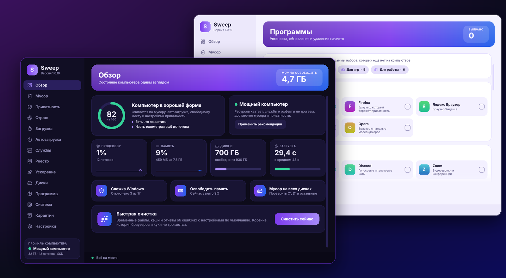
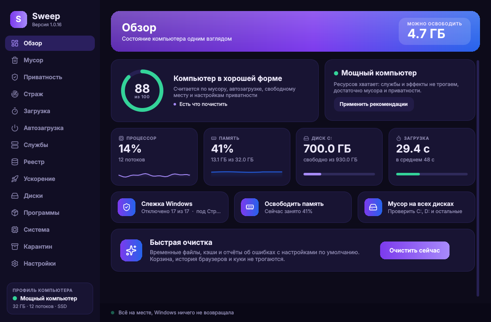
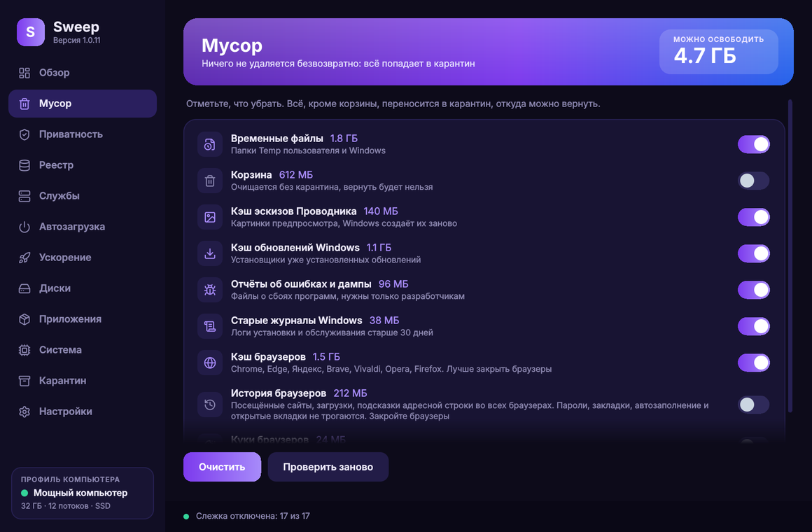
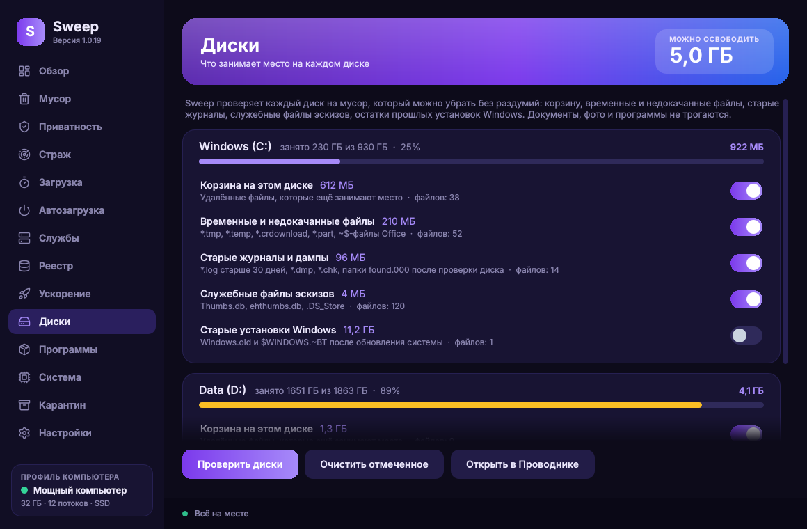
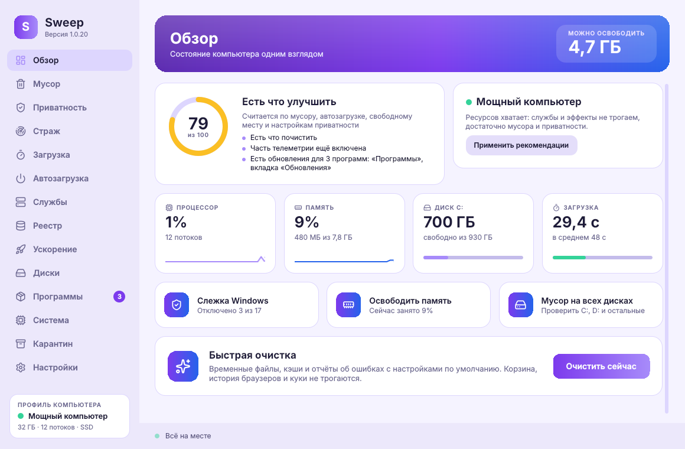

# Sweep

  
  
  
  

<b>Чистка, приватность и ускорение Windows одним нажатием.</b> Бесплатно, открытый код, без рекламы и слежки.

**Версия 1.0** переписана заново: интерфейс на Qt с плавными анимациями, живые графики процессора, памяти и диска, **профиль компьютера**, который подстраивает рекомендации под слабые, средние и мощные машины, пресеты визуальных эффектов и схемы питания Windows, русский и английский, тёмная и светлая темы с пятью акцентными цветами.

Windows 10 и 11. В интернет программа выходит только чтобы проверить обновления на GitHub (при запуске, если это не отключено, или по кнопке). Когда выходит новая версия, Sweep показывает, что изменилось, и спрашивает, обновлять ли. Список изменений: [CHANGELOG.md](CHANGELOG.md) (на английском).

[English](README.md)

## Скачать

Возьмите `Sweep-Setup-x.y.exe` из [последнего выпуска](../../releases/latest) и запустите. Sweep запрашивает права администратора (обычное окно UAC), без них Windows не даёт менять приватность, службы и системную автозагрузку. Если отказаться, программа всё равно откроется, сверху будет кнопка «Дать права».

SmartScreen может предупредить о неизвестном издателе, потому что сборка пока не подписана. Нажмите «Подробнее», затем «Выполнить в любом случае». Исходный код целиком в этом репозитории.

**Если у вас Касперский.** Он помещает неподписанные программы в группу с ограничениями и молча не даёт им менять реестр, поэтому переключатели приватности не сохраняются. Добавьте `C:\Program Files\Sweep\Sweep.exe` в доверенные программы (настройки Kaspersky → «Угрозы и исключения» → «Указать доверенные программы») и отметьте «Не контролировать активность программы». Sweep сам распознаёт эту ситуацию и показывает ту же подсказку в разделе «Приватность».

## Скриншоты

| | |
|---|---|
|  |  |
|  |  |

## Что умеет

**Обзор.** Индекс здоровья от 0 до 100 с подсказками, диск и память одним взглядом, быстрая очистка одной кнопкой.

**Мусор.** Временные файлы, корзина, кэш эскизов, кэш обновлений, отчёты об ошибках, старые журналы, кэш браузеров (Chrome, Edge, Яндекс, Brave, Vivaldi, Opera, Firefox), история браузеров и, по желанию, куки. Очистка истории убирает посещённые сайты, список загрузок и подсказки адресной строки во всех браузерах; пароли, закладки, автозаполнение и открытые вкладки не трогаются. В Firefox история и закладки лежат в одной базе, поэтому удаляются только посещения, а копия базы сначала уходит в карантин. Отмеченные пункты запоминаются.

**Приватность.** 17 переключателей, которые работают как в «Параметрах» Windows (включён, значит функция работает, выключен, значит отключена): сбор данных, реклама и подсказки, помощники Microsoft. Всё обратимо.

**Реестр.** Только безопасные категории, перед изменением каждая ветка сохраняется в `.reg`, кнопка «Вернуть».

**Службы.** Двенадцать служб, которые грузят слабые ПК. Исходная настройка запоминается.

**Автозагрузка.** Что запускается с Windows, переключатель на каждую запись.

**Ускорение.** Освободить память, оптимизировать диски, визуальные эффекты Windows (быстродействие, сбалансированно, красота), схема электропитания, обновления Windows, автоочистка по расписанию раз в неделю.

**Диски.** Каждый диск проверяется на мусор, который можно убрать без раздумий: корзина, временные и недокачанные файлы, старые журналы и дампы, служебные файлы эскизов, остатки прошлых установок Windows. У каждого пункта свой переключатель, отмеченное уходит в карантин.

**Приложения.** Предустановленный мусор Microsoft и партнёров. Удаляете отмеченное, вернуть можно из Microsoft Store.

**Система.** Железо и Windows на одном экране, копирование текстом.

**Карантин.** Ничего не удаляется безвозвратно. Файлы лежат в `ProgramData\Sweep\Quarantine`, кнопка «Вернуть» ставит их на место.

Тёмная и светлая темы, русский и английский интерфейс (переключатель в меню). Интерфейс рисует процессор, видеокарта не используется вовсе, поэтому мышь и игры не подтормаживают, пока Sweep открыт.

## Цифровая подпись

Готовится бесплатная цифровая подпись выпусков для Windows от [SignPath.io](https://about.signpath.io/), сертификат [SignPath Foundation](https://signpath.org/); до одобрения выпуски не подписаны. Сборку делает только GitHub Actions из этого репозитория, каждый запрос на подпись подтверждается вручную. Подробности: [CODE_SIGNING_POLICY.md](CODE_SIGNING_POLICY.md).

## Приватность

Sweep не собирает и не отправляет личные данные и телеметрию. Он обращается только к `api.github.com` и `github.com`, чтобы проверить и скачать обновления Sweep: при запуске (отключается в настройках) или по кнопке «Проверить обновления».

## Сборка

Приложение лежит в `app/`: Python 3.12, PySide6 (Qt 6) с интерфейсом на QML, psutil. Запуск из исходников: `python app/main.py`. Релизы собирает GitHub Actions при каждом изменении на `main`, версия берётся из `APP_VERSION` в `app/sweep/platform.py`. Старая версия на PowerShell лежит в `legacy/`.

## Командная строка

`Sweep.exe --auto` выполняет тихую очистку с настройками по умолчанию и завершается. Так работает задача по расписанию.

## Обратная связь и благодарность

Нашли ошибку или есть идея? [Напишите в Issues](../../issues/new). Если Sweep вам полезен, звёздочка на репозитории это лучшая благодарность автору и помощь другим найти программу.

## Лицензия

MIT. Используйте, изменяйте и распространяйте свободно.
